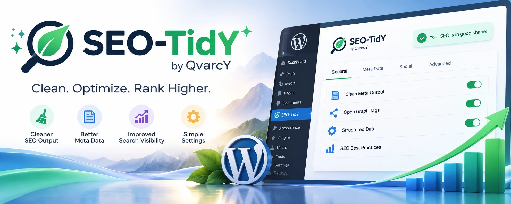

# SEO-TidY

**Free, open-source WordPress SEO and AI search readiness plugin by QvarcY.**

Clean SEO. Smarter discovery. Completely free.

## Release status

**Latest published stable release: [SEO-TidY 1.0.0](https://github.com/QvarcY/wordpress-seo-tidy/releases/tag/v1.0.0)**

Download **[seo-tidy-1.0.0.zip](https://github.com/QvarcY/wordpress-seo-tidy/releases/download/v1.0.0/seo-tidy-1.0.0.zip)** from GitHub Releases under **Assets**. This is the ready-to-install WordPress plugin. Do not use GitHub's automatically generated source archives.

SEO-TidY 1.0.0 is the first stable release, intended for regular WordPress use. Requirements: WordPress 6.8+ and PHP 8.1+. As with any site plugin, keep a backup before updating.

**Release boundaries:** The features listed below describe the published **1.0.0** package. Development branches, draft pull requests and work tested on individual websites are **not** included in an official update until a compatible, versioned GitHub release is published.

## Features available in 1.0.0

- Custom SEO titles and meta descriptions for posts and pages
- WordPress block editor and classic editor metadata support
- Quick metadata editing in the SEO-TidY administration panel
- Automatic BlogPosting and WebPage JSON-LD structured data
- Search result previews with title and description guidance
- SEO audit for duplicate metadata, noindex settings, headings and image ALT
- Existing SEO Audit checks for outgoing and incoming internal content links (not relevance-scored source-to-target suggestions)
- Incoming-link audit is unavailable above 200 eligible published posts/pages; this limit does not apply to a future recommendation index
- Review of missing or unpublished WordPress post-ID link targets
- Affected URL details for supported link checks
- Cached incoming link and duplicate metadata analysis
- SEO metadata and content audit
- Answer readiness content-structure suggestions
- Yoast SEO and Rank Math metadata import
- Centralized output and audit settings
- English and Latvian administration interface
- Optional local daily pageview analytics with separate suspected-bot counts
- Configurable statistics badge with shortcode `[seo_tidy_stats]`
- Optional statistics badge in the website footer
- Light, dark and transparent badge themes
- Opt-in Wall of Fame directory with verified submissions, moderated editable website profiles, public SEO-friendly profile pages, moderator notifications and a compact paginated directory
- Administrator-controlled statistics deletion and daily data retention

Content recommendations are heuristic and do not guarantee search
rankings, indexing, or inclusion in AI-generated answers.

## Development roadmap — not included in 1.0.0

The following items are **under development or proposed**, not promises of a release date. They are **not installed by updating to 1.0.0**. Track progress and remaining acceptance checks through the linked GitHub issues and pull requests.

### In development: relevance-aware internal linking

[Issue #29](https://github.com/QvarcY/wordpress-seo-tidy/issues/29) · [Draft PR #31](https://github.com/QvarcY/wordpress-seo-tidy/pull/31)

- **Smart Topics:** privately review and approve subjects for an article without creating public WordPress tags.
- **Local, explainable recommendations:** build a bounded index, rank candidate articles with BM25 and show the source, destination and matching context for **manual editorial review**. No automatic insertion into published articles.
- **Safety checks:** avoid self-links, existing links, ineligible/noindex content, and weak or potentially competing article pairs.
- **Index maintenance:** explicit administrator-run batches, rebuilds and stale-index handling, without paid SEO APIs or external AI services.

**Status:** experimental work, not release-ready. Deterministic checks and isolated WordPress/MariaDB integration and performance measurements have been recorded; concurrent scan and edit races exposed blocking freshness defects. Those defects and other compatibility and quality checks must pass before a public release. The latest development work may exist only in a local checkout and is not necessarily on GitHub.

The existing 1.0.0 **SEO Audit internal-link checks** and the proposed **relevance-aware source-to-target recommendation system** are different features.

### Planned: international article-language management

[Language-management requirements in Issue #29](https://github.com/QvarcY/wordpress-seo-tidy/issues/29)

- A site-wide default **new article language** chosen during setup or later in SEO-TidY Settings, with WordPress site locale as an editable suggestion — **no hard-coded Latvian or English default**.
- An optional **per-author default** and a prominent, editable language selector near the publishing controls in both block and classic editors.
- Clear language columns, filters and bounded bulk assignment for **existing** posts/pages, with an Unassigned / Needs review state instead of silently relabeling older content.
- Language-aware internal-link recommendations: normally recommend articles in the **same confirmed language**; ambiguous or mixed-language cases require review.
- Initially validated EN/LV stopwords and language-scoped BM25 statistics; other languages should have conservative behavior with accurately described limitations.

### Future multilingual integrations and quality improvements

- Respect authoritative WPML/Polylang language and translation relationships when those plugins are used; avoid conflicting controls and duplicate language output.
- Review related language versions separately from ordinary topic-link suggestions, and optionally inspect existing `hreflang` relationships without rewriting content or canonicals.
- Expand real-site editorial review using published multilingual articles, including relevant articles on [kas.id.lv](https://kas.id.lv/), with user feedback informing usability and recommendation refinements.

**Feedback is welcome:** inaccurate recommendations, confusing workflows, translation issues, bugs and feature ideas can be reported through [GitHub Issues](https://github.com/QvarcY/wordpress-seo-tidy/issues/new). Reports are reviewed; actionable and feasible improvements are considered for subsequent updates.

## Wall of Fame — public directory

**[Explore the SEO-TidY Wall of Fame](https://kas.id.lv/SEO-TidY/Wall-Of-Fame/)**

The public Wall of Fame showcases websites that have joined through SEO-TidY. Website owners can submit their sites for ownership verification and moderator review. Approved owners can also publish a detailed, moderated profile featuring a description, category and tags.

Participation is optional. The public directory and approved profiles are available to visitors without installing the plugin.

## Requirements

- WordPress 6.8 or newer
- PHP 8.1 or newer

## Installation

1. Open the [stable 1.0.0 release](https://github.com/QvarcY/wordpress-seo-tidy/releases/tag/v1.0.0) and expand **Assets**.
2. Download **[seo-tidy-1.0.0.zip](https://github.com/QvarcY/wordpress-seo-tidy/releases/download/v1.0.0/seo-tidy-1.0.0.zip)** (not the source archives).
3. In WordPress, open Plugins > Add New Plugin > Upload Plugin.
4. Select the downloaded ZIP and choose Install Now.
5. Activate SEO-TidY.
6. Open SEO-TidY in the WordPress administration menu.

The ZIP already contains compiled JavaScript assets.
Node.js and npm are not required for normal installation.

## Updates through WordPress

SEO-TidY includes a GitHub release updater in **1.0.0**. You normally do **not** need to uninstall the plugin or manually upload another ZIP to install a later compatible official release.

1. In WordPress administration, open **Dashboard > Updates** or **Plugins** and check for available updates.
2. When a newer eligible SEO-TidY release is offered, review its release notes and your backup, then choose the usual WordPress **Update now** action.
3. If it does not appear immediately, use **Dashboard > Updates > Check Again**. GitHub release metadata can be cached for up to 12 hours, and the site must be able to reach GitHub.

The updater looks for eligible GitHub releases with a versioned tag such as `v1.1.0` and a matching **release asset** named `seo-tidy-1.1.0.zip`. An ordinary Git commit, development branch, draft PR, GitHub source archive or undocumented ZIP is **not** an installable WordPress update. Experimental beta releases are only considered when beta updates are enabled in SEO-TidY settings, and they must still be newer than the installed version. Automatic background updating is **not enabled** by the SEO-TidY updater.

Publishing documentation or closing an issue does not itself publish a plugin update. A tested, tagged GitHub release with the correct ZIP asset is required. The current published stable package remains **1.0.0**.

## Getting started

1. Open Dashboard to see published content statistics.
2. Open Metadata to review and edit SEO titles and descriptions.
3. Open Smart Schema or Settings to control structured data.
4. Open SEO Audit and Answer Readiness for content suggestions.
5. Use Migration only after making a database backup.

Migration imports available metadata into empty SEO-TidY fields.
It does not intentionally delete the source plugin's metadata.
Review the preview and confirm before importing.

Using multiple SEO plugins at once may create duplicate metadata
or structured data. Check the public page output before deployment.

## Analytics and privacy

SEO-TidY Analytics is **disabled by default**. Enabling it records
aggregated daily counts of eligible public page requests in the
WordPress database. The analytics engine does not persist raw IP
addresses or create a separate visitor event log.

- Human-classified pageviews are requests, not unique visitors.
- Suspected bots are identified heuristically from user agents.
- The bot classification can be inaccurate or manipulated.
- WordPress administrators and logged-in users are excluded.
- Non-GET and several non-public requests are excluded.
- Full-page caches, CDNs and other caching layers may bypass
  WordPress, so totals may be lower than actual traffic.
- The built-in engine does not calculate reliable unique visitors
  or real-time online visitor counts.
- Statistics are stored by calendar day for up to 365 days.
- Old rows are removed using WordPress scheduled tasks.
  WordPress cron depends on site activity or external cron setup.
- Administrators can explicitly delete all recorded statistics
  from the Analytics screen after a confirmation prompt.

The statistics badge is optional. The footer badge and the
Powered by SEO-TidY attribution are disabled by default.
The shortcode can be used where a badge is wanted.

Wall of Fame is optional. Owners submit their website for verification and moderator review. Approved website names, URLs and descriptions appear in the public community directory. Approved site owners can submit a detailed profile with category and tags for moderation; public profiles have crawlable HTML pages. The directory is also shown in the SEO-TidY dashboard with pagination and profile links. Central moderation is limited to the authorized hosting environment.

Site owners remain responsible for providing appropriate privacy
information to their visitors.

## Contributing

SEO-TidY welcomes international WordPress developers, testers, designers, translators and documentation contributors. Please see the [**help wanted contributor hub (Issue #32)**](https://github.com/QvarcY/wordpress-seo-tidy/issues/32), choose one scoped task and comment with your proposed approach before starting substantial work.

Open opportunities include [installation and WordPress update testing (#33)](https://github.com/QvarcY/wordpress-seo-tidy/issues/33), [improving the existing incoming-link audit for larger sites (#34)](https://github.com/QvarcY/wordpress-seo-tidy/issues/34), and [contributor guidelines and issue templates (#36)](https://github.com/QvarcY/wordpress-seo-tidy/issues/36). The release-pipeline preparation task (#35) is completed.

The [experimental internal-linking PR #31](https://github.com/QvarcY/wordpress-seo-tidy/pull/31) remains **Draft** and is not part of v1.0.0. Read the [maintainer development handoff](docs/DEVELOPMENT-HANDOFF.md) for the latest checkpoint, remaining release blockers and a safe resumption path. Contributors should coordinate before changing this draft implementation.

## Development

Install dependencies with `npm ci` and build with `npm run build`.

Source code: https://github.com/QvarcY/wordpress-seo-tidy

## License

GPL-2.0-or-later. See [LICENSE](LICENSE).

## Support

- GitHub: https://github.com/QvarcY
- Report bugs, inaccurate suggestions, usability problems or feature requests: https://github.com/QvarcY/wordpress-seo-tidy/issues/new
- Follow the feature roadmap: https://github.com/QvarcY/wordpress-seo-tidy/issues/29
- Buy Me a Coffee: https://buymeacoffee.com/craftin

Donations are optional. Every SEO-TidY feature remains free.